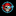
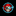
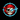

# The Pirate Ray branding

The official project name is **The Pirate Ray**.

`the-pirate-ray-logo.png` is the original transparent project logo supplied by
the project owner for use by this project. It is stored without resizing,
re-encoding, or other modification.

- Dimensions: 1254 x 1254 pixels
- Format: 32-bit ARGB PNG
- SHA-256: `afcd7e457b5bf9cf92a7222b3ab8a2850d75c05bc2c37d242c959cd7569e6fa4`

Use the transparent original by default. If a derivative needs an opaque
background, the background must be black. Do not use another background
color.

## Quick selection guide

| Need | Recommended asset |
|---|---|
| General logo with transparency | `generated/png/transparent/` at the nearest suitable size |
| Icon that may be rounded or cropped | `generated/png/safe-zone/` |
| PWA/installable website | `generated/web/site.webmanifest` and `maskable-icon-*` |
| Windows application | `generated/windows/app.ico` |
| macOS application | `generated/macos/AppIcon.icns` |
| iPhone/iPad application | `generated/ios/AppIcon.appiconset/` |
| Android application | `generated/android/` |
| Linux desktop application | `generated/linux/hicolor/` |
| Tray, notification, stencil, or engraving | `generated/png/monochrome-white/` or `monochrome-black/` |
| Social profile or link preview | `generated/social/` |

The catalog below lists all 128 generated image files individually.

## Canonical artwork

| Preview | File | Dimensions | Background / safe area | Recommended use |
|---|---|---:|---|---|
 | [`the-pirate-ray-logo.png`](the-pirate-ray-logo.png) | 1254 x 1254 | Transparent, full-bleed | Canonical master. Use for new derivatives and full-resolution layouts; never overwrite or re-encode it. |

## PNG — transparent, full-bleed

| Preview | File | Dimensions | Background / safe area | Recommended use |
|---|---|---:|---|---|
 | [`png/transparent/logo-16.png`](generated/png/transparent/logo-16.png) | 16 x 16 | Transparent | Small UI, browser chrome, or tray use where full artwork may reach the edge. |
 | [`png/transparent/logo-20.png`](generated/png/transparent/logo-20.png) | 20 x 20 | Transparent | Small UI, browser chrome, or tray use where full artwork may reach the edge. |
 | [`png/transparent/logo-24.png`](generated/png/transparent/logo-24.png) | 24 x 24 | Transparent | Small UI, browser chrome, or tray use where full artwork may reach the edge. |
 | [`png/transparent/logo-32.png`](generated/png/transparent/logo-32.png) | 32 x 32 | Transparent | Small UI, browser chrome, or tray use where full artwork may reach the edge. |
 | [`png/transparent/logo-40.png`](generated/png/transparent/logo-40.png) | 40 x 40 | Transparent | Small UI, browser chrome, or tray use where full artwork may reach the edge. |
 | [`png/transparent/logo-48.png`](generated/png/transparent/logo-48.png) | 48 x 48 | Transparent | Small UI, browser chrome, or tray use where full artwork may reach the edge. |
 | [`png/transparent/logo-64.png`](generated/png/transparent/logo-64.png) | 64 x 64 | Transparent | General UI, documentation, avatars, and compact placements on any background. |
 | [`png/transparent/logo-72.png`](generated/png/transparent/logo-72.png) | 72 x 72 | Transparent | General UI, documentation, avatars, and compact placements on any background. |
 | [`png/transparent/logo-96.png`](generated/png/transparent/logo-96.png) | 96 x 96 | Transparent | General UI, documentation, avatars, and compact placements on any background. |
 | [`png/transparent/logo-128.png`](generated/png/transparent/logo-128.png) | 128 x 128 | Transparent | General UI, documentation, avatars, and compact placements on any background. |
 | [`png/transparent/logo-144.png`](generated/png/transparent/logo-144.png) | 144 x 144 | Transparent | General UI, documentation, avatars, and compact placements on any background. |
 | [`png/transparent/logo-152.png`](generated/png/transparent/logo-152.png) | 152 x 152 | Transparent | General UI, documentation, avatars, and compact placements on any background. |
 | [`png/transparent/logo-180.png`](generated/png/transparent/logo-180.png) | 180 x 180 | Transparent | General UI, documentation, avatars, and compact placements on any background. |
 | [`png/transparent/logo-192.png`](generated/png/transparent/logo-192.png) | 192 x 192 | Transparent | General UI, documentation, avatars, and compact placements on any background. |
 | [`png/transparent/logo-256.png`](generated/png/transparent/logo-256.png) | 256 x 256 | Transparent | General high-resolution placement, print/layout source, and manual exports. |
 | [`png/transparent/logo-384.png`](generated/png/transparent/logo-384.png) | 384 x 384 | Transparent | General high-resolution placement, print/layout source, and manual exports. |
 | [`png/transparent/logo-512.png`](generated/png/transparent/logo-512.png) | 512 x 512 | Transparent | General high-resolution placement, print/layout source, and manual exports. |
 | [`png/transparent/logo-1024.png`](generated/png/transparent/logo-1024.png) | 1024 x 1024 | Transparent | General high-resolution placement, print/layout source, and manual exports. |

## PNG — opaque on black

| Preview | File | Dimensions | Background / safe area | Recommended use |
|---|---|---:|---|---|
 | [`png/on-black/logo-16.png`](generated/png/on-black/logo-16.png) | 16 x 16 | Opaque black | Use where transparency is unsupported or a guaranteed black brand background is required. |
 | [`png/on-black/logo-20.png`](generated/png/on-black/logo-20.png) | 20 x 20 | Opaque black | Use where transparency is unsupported or a guaranteed black brand background is required. |
 | [`png/on-black/logo-24.png`](generated/png/on-black/logo-24.png) | 24 x 24 | Opaque black | Use where transparency is unsupported or a guaranteed black brand background is required. |
 | [`png/on-black/logo-32.png`](generated/png/on-black/logo-32.png) | 32 x 32 | Opaque black | Use where transparency is unsupported or a guaranteed black brand background is required. |
 | [`png/on-black/logo-40.png`](generated/png/on-black/logo-40.png) | 40 x 40 | Opaque black | Use where transparency is unsupported or a guaranteed black brand background is required. |
 | [`png/on-black/logo-48.png`](generated/png/on-black/logo-48.png) | 48 x 48 | Opaque black | Use where transparency is unsupported or a guaranteed black brand background is required. |
 | [`png/on-black/logo-64.png`](generated/png/on-black/logo-64.png) | 64 x 64 | Opaque black | Use where transparency is unsupported or a guaranteed black brand background is required. |
 | [`png/on-black/logo-72.png`](generated/png/on-black/logo-72.png) | 72 x 72 | Opaque black | Use where transparency is unsupported or a guaranteed black brand background is required. |
 | [`png/on-black/logo-96.png`](generated/png/on-black/logo-96.png) | 96 x 96 | Opaque black | Use where transparency is unsupported or a guaranteed black brand background is required. |
 | [`png/on-black/logo-128.png`](generated/png/on-black/logo-128.png) | 128 x 128 | Opaque black | Use where transparency is unsupported or a guaranteed black brand background is required. |
 | [`png/on-black/logo-144.png`](generated/png/on-black/logo-144.png) | 144 x 144 | Opaque black | Use where transparency is unsupported or a guaranteed black brand background is required. |
 | [`png/on-black/logo-152.png`](generated/png/on-black/logo-152.png) | 152 x 152 | Opaque black | Use where transparency is unsupported or a guaranteed black brand background is required. |
 | [`png/on-black/logo-180.png`](generated/png/on-black/logo-180.png) | 180 x 180 | Opaque black | Use where transparency is unsupported or a guaranteed black brand background is required. |
 | [`png/on-black/logo-192.png`](generated/png/on-black/logo-192.png) | 192 x 192 | Opaque black | Use where transparency is unsupported or a guaranteed black brand background is required. |
 | [`png/on-black/logo-256.png`](generated/png/on-black/logo-256.png) | 256 x 256 | Opaque black | Use where transparency is unsupported or a guaranteed black brand background is required. |
 | [`png/on-black/logo-384.png`](generated/png/on-black/logo-384.png) | 384 x 384 | Opaque black | Use where transparency is unsupported or a guaranteed black brand background is required. |
 | [`png/on-black/logo-512.png`](generated/png/on-black/logo-512.png) | 512 x 512 | Opaque black | Use where transparency is unsupported or a guaranteed black brand background is required. |
 | [`png/on-black/logo-1024.png`](generated/png/on-black/logo-1024.png) | 1024 x 1024 | Opaque black | Use where transparency is unsupported or a guaranteed black brand background is required. |

## PNG — transparent safe-zone

| Preview | File | Dimensions | Background / safe area | Recommended use |
|---|---|---:|---|---|
 | [`png/safe-zone/logo-16.png`](generated/png/safe-zone/logo-16.png) | 16 x 16 | Transparent, 11% margin | App chrome, launchers, or UI containers that may crop or round the image. |
 | [`png/safe-zone/logo-32.png`](generated/png/safe-zone/logo-32.png) | 32 x 32 | Transparent, 11% margin | App chrome, launchers, or UI containers that may crop or round the image. |
 | [`png/safe-zone/logo-48.png`](generated/png/safe-zone/logo-48.png) | 48 x 48 | Transparent, 11% margin | App chrome, launchers, or UI containers that may crop or round the image. |
 | [`png/safe-zone/logo-64.png`](generated/png/safe-zone/logo-64.png) | 64 x 64 | Transparent, 11% margin | App chrome, launchers, or UI containers that may crop or round the image. |
 | [`png/safe-zone/logo-128.png`](generated/png/safe-zone/logo-128.png) | 128 x 128 | Transparent, 11% margin | App chrome, launchers, or UI containers that may crop or round the image. |
 | [`png/safe-zone/logo-256.png`](generated/png/safe-zone/logo-256.png) | 256 x 256 | Transparent, 11% margin | App chrome, launchers, or UI containers that may crop or round the image. |
 | [`png/safe-zone/logo-512.png`](generated/png/safe-zone/logo-512.png) | 512 x 512 | Transparent, 11% margin | App chrome, launchers, or UI containers that may crop or round the image. |
 | [`png/safe-zone/logo-1024.png`](generated/png/safe-zone/logo-1024.png) | 1024 x 1024 | Transparent, 11% margin | App chrome, launchers, or UI containers that may crop or round the image. |

## PNG — monochrome white

| Preview | File | Dimensions | Background / safe area | Recommended use |
|---|---|---:|---|---|
 | [`png/monochrome-white/logo-16.png`](generated/png/monochrome-white/logo-16.png) | 16 x 16 | Transparent; white silhouette | Dark system bars, notification glyphs, vinyl/stencil work, or one-color output. |
 | [`png/monochrome-white/logo-32.png`](generated/png/monochrome-white/logo-32.png) | 32 x 32 | Transparent; white silhouette | Dark system bars, notification glyphs, vinyl/stencil work, or one-color output. |
 | [`png/monochrome-white/logo-48.png`](generated/png/monochrome-white/logo-48.png) | 48 x 48 | Transparent; white silhouette | Dark system bars, notification glyphs, vinyl/stencil work, or one-color output. |
 | [`png/monochrome-white/logo-64.png`](generated/png/monochrome-white/logo-64.png) | 64 x 64 | Transparent; white silhouette | Dark system bars, notification glyphs, vinyl/stencil work, or one-color output. |
 | [`png/monochrome-white/logo-128.png`](generated/png/monochrome-white/logo-128.png) | 128 x 128 | Transparent; white silhouette | Dark system bars, notification glyphs, vinyl/stencil work, or one-color output. |
 | [`png/monochrome-white/logo-256.png`](generated/png/monochrome-white/logo-256.png) | 256 x 256 | Transparent; white silhouette | Dark system bars, notification glyphs, vinyl/stencil work, or one-color output. |
 | [`png/monochrome-white/logo-512.png`](generated/png/monochrome-white/logo-512.png) | 512 x 512 | Transparent; white silhouette | Dark system bars, notification glyphs, vinyl/stencil work, or one-color output. |
 | [`png/monochrome-white/logo-1024.png`](generated/png/monochrome-white/logo-1024.png) | 1024 x 1024 | Transparent; white silhouette | Dark system bars, notification glyphs, vinyl/stencil work, or one-color output. |

## PNG — monochrome black

| Preview | File | Dimensions | Background / safe area | Recommended use |
|---|---|---:|---|---|
 | [`png/monochrome-black/logo-16.png`](generated/png/monochrome-black/logo-16.png) | 16 x 16 | Transparent; black silhouette | Light system bars, print, engraving masks, or one-color output. |
 | [`png/monochrome-black/logo-32.png`](generated/png/monochrome-black/logo-32.png) | 32 x 32 | Transparent; black silhouette | Light system bars, print, engraving masks, or one-color output. |
 | [`png/monochrome-black/logo-48.png`](generated/png/monochrome-black/logo-48.png) | 48 x 48 | Transparent; black silhouette | Light system bars, print, engraving masks, or one-color output. |
 | [`png/monochrome-black/logo-64.png`](generated/png/monochrome-black/logo-64.png) | 64 x 64 | Transparent; black silhouette | Light system bars, print, engraving masks, or one-color output. |
 | [`png/monochrome-black/logo-128.png`](generated/png/monochrome-black/logo-128.png) | 128 x 128 | Transparent; black silhouette | Light system bars, print, engraving masks, or one-color output. |
 | [`png/monochrome-black/logo-256.png`](generated/png/monochrome-black/logo-256.png) | 256 x 256 | Transparent; black silhouette | Light system bars, print, engraving masks, or one-color output. |
 | [`png/monochrome-black/logo-512.png`](generated/png/monochrome-black/logo-512.png) | 512 x 512 | Transparent; black silhouette | Light system bars, print, engraving masks, or one-color output. |
 | [`png/monochrome-black/logo-1024.png`](generated/png/monochrome-black/logo-1024.png) | 1024 x 1024 | Transparent; black silhouette | Light system bars, print, engraving masks, or one-color output. |

## Web and PWA

| Preview | File | Dimensions | Background / safe area | Recommended use |
|---|---|---:|---|---|
 | [`web/favicon.ico`](generated/web/favicon.ico) | 16–48 px | Transparent | Multi-resolution legacy browser favicon (16, 32, and 48 px). |
 | [`web/favicon-16x16.png`](generated/web/favicon-16x16.png) | 16 x 16 | Transparent | Browser tab/favicon at 16 px; reference from HTML with rel=icon. |
 | [`web/favicon-32x32.png`](generated/web/favicon-32x32.png) | 32 x 32 | Transparent | Browser tab/favicon at 32 px; reference from HTML with rel=icon. |
 | [`web/apple-touch-icon.png`](generated/web/apple-touch-icon.png) | 180 x 180 | Transparent | iOS/iPadOS home-screen bookmark; reference with rel=apple-touch-icon. |
 | [`web/icon-192.png`](generated/web/icon-192.png) | 192 x 192 | Transparent | Standard PWA/web-app manifest icon; set purpose to any. |
 | [`web/maskable-icon-192.png`](generated/web/maskable-icon-192.png) | 192 x 192 | Opaque black | PWA manifest icon with extra safe area; set purpose to maskable. |
 | [`web/icon-512.png`](generated/web/icon-512.png) | 512 x 512 | Transparent | Standard PWA/web-app manifest icon; set purpose to any. |
 | [`web/maskable-icon-512.png`](generated/web/maskable-icon-512.png) | 512 x 512 | Opaque black | PWA manifest icon with extra safe area; set purpose to maskable. |

## Windows

| Preview | File | Dimensions | Background / safe area | Recommended use |
|---|---|---:|---|---|
 | [`windows/app.ico`](generated/windows/app.ico) | 16–256 px | Opaque black, padded | Windows executable, installer, shortcut, and window icon (16–256 px). |
 | [`windows/store/BadgeLogo.png`](generated/windows/store/BadgeLogo.png) | 24 x 24 | Opaque black | Windows package badge asset. |
 | [`windows/store/Square44x44Logo.png`](generated/windows/store/Square44x44Logo.png) | 44 x 44 | Opaque black | Windows package/Start tile asset matching the size encoded in its filename. |
 | [`windows/store/StoreLogo.png`](generated/windows/store/StoreLogo.png) | 50 x 50 | Opaque black | Microsoft Store package logo. |
 | [`windows/store/Square71x71Logo.png`](generated/windows/store/Square71x71Logo.png) | 71 x 71 | Opaque black | Windows package/Start tile asset matching the size encoded in its filename. |
 | [`windows/store/Square150x150Logo.png`](generated/windows/store/Square150x150Logo.png) | 150 x 150 | Opaque black | Windows package/Start tile asset matching the size encoded in its filename. |
 | [`windows/store/Square310x310Logo.png`](generated/windows/store/Square310x310Logo.png) | 310 x 310 | Opaque black | Windows package/Start tile asset matching the size encoded in its filename. |
 | [`windows/store/Wide310x150Logo.png`](generated/windows/store/Wide310x150Logo.png) | 310 x 150 | Opaque black | Wide Windows Start tile/package visual. |

## macOS

| Preview | File | Dimensions | Background / safe area | Recommended use |
|---|---|---:|---|---|
 | [`macos/AppIcon.icns`](generated/macos/AppIcon.icns) | 16–1024 px | Opaque black, padded | Ready-to-use macOS app-bundle icon containing platform resolutions. |
 | [`macos/AppIcon.iconset/icon_16x16.png`](generated/macos/AppIcon.iconset/icon_16x16.png) | 16 x 16 | Opaque black, padded | macOS iconset source; keep the filename unchanged for Xcode or iconutil. |
 | [`macos/AppIcon.iconset/icon_16x16@2x.png`](generated/macos/AppIcon.iconset/icon_16x16@2x.png) | 32 x 32 | Opaque black, padded | macOS iconset source; keep the filename unchanged for Xcode or iconutil. |
 | [`macos/AppIcon.iconset/icon_32x32.png`](generated/macos/AppIcon.iconset/icon_32x32.png) | 32 x 32 | Opaque black, padded | macOS iconset source; keep the filename unchanged for Xcode or iconutil. |
 | [`macos/AppIcon.iconset/icon_32x32@2x.png`](generated/macos/AppIcon.iconset/icon_32x32@2x.png) | 64 x 64 | Opaque black, padded | macOS iconset source; keep the filename unchanged for Xcode or iconutil. |
 | [`macos/AppIcon.iconset/icon_128x128.png`](generated/macos/AppIcon.iconset/icon_128x128.png) | 128 x 128 | Opaque black, padded | macOS iconset source; keep the filename unchanged for Xcode or iconutil. |
 | [`macos/AppIcon.iconset/icon_128x128@2x.png`](generated/macos/AppIcon.iconset/icon_128x128@2x.png) | 256 x 256 | Opaque black, padded | macOS iconset source; keep the filename unchanged for Xcode or iconutil. |
 | [`macos/AppIcon.iconset/icon_256x256.png`](generated/macos/AppIcon.iconset/icon_256x256.png) | 256 x 256 | Opaque black, padded | macOS iconset source; keep the filename unchanged for Xcode or iconutil. |
 | [`macos/AppIcon.iconset/icon_256x256@2x.png`](generated/macos/AppIcon.iconset/icon_256x256@2x.png) | 512 x 512 | Opaque black, padded | macOS iconset source; keep the filename unchanged for Xcode or iconutil. |
 | [`macos/AppIcon.iconset/icon_512x512.png`](generated/macos/AppIcon.iconset/icon_512x512.png) | 512 x 512 | Opaque black, padded | macOS iconset source; keep the filename unchanged for Xcode or iconutil. |
 | [`macos/AppIcon.iconset/icon_512x512@2x.png`](generated/macos/AppIcon.iconset/icon_512x512@2x.png) | 1024 x 1024 | Opaque black, padded | macOS iconset source; keep the filename unchanged for Xcode or iconutil. |

## iOS and iPadOS

| Preview | File | Dimensions | Background / safe area | Recommended use |
|---|---|---:|---|---|
 | [`ios/AppIcon.appiconset/icon-20@1x.png`](generated/ios/AppIcon.appiconset/icon-20@1x.png) | 20 x 20 | Opaque black, padded | iOS/iPadOS notifications icon; use through the included AppIcon asset catalog. |
 | [`ios/AppIcon.appiconset/icon-29@1x.png`](generated/ios/AppIcon.appiconset/icon-29@1x.png) | 29 x 29 | Opaque black, padded | iOS/iPadOS Settings icon; use through the included AppIcon asset catalog. |
 | [`ios/AppIcon.appiconset/icon-20@2x.png`](generated/ios/AppIcon.appiconset/icon-20@2x.png) | 40 x 40 | Opaque black, padded | iOS/iPadOS notifications icon; use through the included AppIcon asset catalog. |
 | [`ios/AppIcon.appiconset/icon-40@1x.png`](generated/ios/AppIcon.appiconset/icon-40@1x.png) | 40 x 40 | Opaque black, padded | iOS/iPadOS Spotlight icon; use through the included AppIcon asset catalog. |
 | [`ios/AppIcon.appiconset/icon-29@2x.png`](generated/ios/AppIcon.appiconset/icon-29@2x.png) | 58 x 58 | Opaque black, padded | iOS/iPadOS Settings icon; use through the included AppIcon asset catalog. |
 | [`ios/AppIcon.appiconset/icon-20@3x.png`](generated/ios/AppIcon.appiconset/icon-20@3x.png) | 60 x 60 | Opaque black, padded | iOS/iPadOS notifications icon; use through the included AppIcon asset catalog. |
 | [`ios/AppIcon.appiconset/icon-76@1x.png`](generated/ios/AppIcon.appiconset/icon-76@1x.png) | 76 x 76 | Opaque black, padded | iOS/iPadOS iPad app icon; use through the included AppIcon asset catalog. |
 | [`ios/AppIcon.appiconset/icon-40@2x.png`](generated/ios/AppIcon.appiconset/icon-40@2x.png) | 80 x 80 | Opaque black, padded | iOS/iPadOS Spotlight icon; use through the included AppIcon asset catalog. |
 | [`ios/AppIcon.appiconset/icon-29@3x.png`](generated/ios/AppIcon.appiconset/icon-29@3x.png) | 87 x 87 | Opaque black, padded | iOS/iPadOS Settings icon; use through the included AppIcon asset catalog. |
 | [`ios/AppIcon.appiconset/icon-40@3x.png`](generated/ios/AppIcon.appiconset/icon-40@3x.png) | 120 x 120 | Opaque black, padded | iOS/iPadOS Spotlight icon; use through the included AppIcon asset catalog. |
 | [`ios/AppIcon.appiconset/icon-60@2x.png`](generated/ios/AppIcon.appiconset/icon-60@2x.png) | 120 x 120 | Opaque black, padded | iOS/iPadOS iPhone app icon; use through the included AppIcon asset catalog. |
 | [`ios/AppIcon.appiconset/icon-76@2x.png`](generated/ios/AppIcon.appiconset/icon-76@2x.png) | 152 x 152 | Opaque black, padded | iOS/iPadOS iPad app icon; use through the included AppIcon asset catalog. |
 | [`ios/AppIcon.appiconset/icon-83.5@2x.png`](generated/ios/AppIcon.appiconset/icon-83.5@2x.png) | 167 x 167 | Opaque black, padded | iOS/iPadOS iPad Pro app icon; use through the included AppIcon asset catalog. |
 | [`ios/AppIcon.appiconset/icon-60@3x.png`](generated/ios/AppIcon.appiconset/icon-60@3x.png) | 180 x 180 | Opaque black, padded | iOS/iPadOS iPhone app icon; use through the included AppIcon asset catalog. |
 | [`ios/AppIcon.appiconset/icon-1024.png`](generated/ios/AppIcon.appiconset/icon-1024.png) | 1024 x 1024 | Opaque black, padded | App Store marketing icon. |

## Android

| Preview | File | Dimensions | Background / safe area | Recommended use |
|---|---|---:|---|---|
 | [`android/mipmap-mdpi/ic_launcher.png`](generated/android/mipmap-mdpi/ic_launcher.png) | 48 x 48 | Opaque black, padded | Legacy Android launcher icon for the named display density. |
 | [`android/mipmap-mdpi/ic_launcher_round.png`](generated/android/mipmap-mdpi/ic_launcher_round.png) | 48 x 48 | Opaque black, padded | Legacy round Android launcher icon for the named display density. |
 | [`android/mipmap-hdpi/ic_launcher.png`](generated/android/mipmap-hdpi/ic_launcher.png) | 72 x 72 | Opaque black, padded | Legacy Android launcher icon for the named display density. |
 | [`android/mipmap-hdpi/ic_launcher_round.png`](generated/android/mipmap-hdpi/ic_launcher_round.png) | 72 x 72 | Opaque black, padded | Legacy round Android launcher icon for the named display density. |
 | [`android/mipmap-xhdpi/ic_launcher.png`](generated/android/mipmap-xhdpi/ic_launcher.png) | 96 x 96 | Opaque black, padded | Legacy Android launcher icon for the named display density. |
 | [`android/mipmap-xhdpi/ic_launcher_round.png`](generated/android/mipmap-xhdpi/ic_launcher_round.png) | 96 x 96 | Opaque black, padded | Legacy round Android launcher icon for the named display density. |
 | [`android/drawable-mdpi/ic_launcher_foreground.png`](generated/android/drawable-mdpi/ic_launcher_foreground.png) | 108 x 108 | Transparent adaptive foreground | Android adaptive-icon foreground for the density named in the parent folder. |
 | [`android/mipmap-xxhdpi/ic_launcher.png`](generated/android/mipmap-xxhdpi/ic_launcher.png) | 144 x 144 | Opaque black, padded | Legacy Android launcher icon for the named display density. |
 | [`android/mipmap-xxhdpi/ic_launcher_round.png`](generated/android/mipmap-xxhdpi/ic_launcher_round.png) | 144 x 144 | Opaque black, padded | Legacy round Android launcher icon for the named display density. |
 | [`android/drawable-hdpi/ic_launcher_foreground.png`](generated/android/drawable-hdpi/ic_launcher_foreground.png) | 162 x 162 | Transparent adaptive foreground | Android adaptive-icon foreground for the density named in the parent folder. |
 | [`android/mipmap-xxxhdpi/ic_launcher.png`](generated/android/mipmap-xxxhdpi/ic_launcher.png) | 192 x 192 | Opaque black, padded | Legacy Android launcher icon for the named display density. |
 | [`android/mipmap-xxxhdpi/ic_launcher_round.png`](generated/android/mipmap-xxxhdpi/ic_launcher_round.png) | 192 x 192 | Opaque black, padded | Legacy round Android launcher icon for the named display density. |
 | [`android/drawable-xhdpi/ic_launcher_foreground.png`](generated/android/drawable-xhdpi/ic_launcher_foreground.png) | 216 x 216 | Transparent adaptive foreground | Android adaptive-icon foreground for the density named in the parent folder. |
 | [`android/drawable-xxhdpi/ic_launcher_foreground.png`](generated/android/drawable-xxhdpi/ic_launcher_foreground.png) | 324 x 324 | Transparent adaptive foreground | Android adaptive-icon foreground for the density named in the parent folder. |
 | [`android/drawable-xxxhdpi/ic_launcher_foreground.png`](generated/android/drawable-xxxhdpi/ic_launcher_foreground.png) | 432 x 432 | Transparent adaptive foreground | Android adaptive-icon foreground for the density named in the parent folder. |

## Linux / freedesktop

| Preview | File | Dimensions | Background / safe area | Recommended use |
|---|---|---:|---|---|
 | [`linux/hicolor/16x16/apps/the-pirate-ray.png`](generated/linux/hicolor/16x16/apps/the-pirate-ray.png) | 16 x 16 | Transparent | Linux desktop/app-menu icon; install in the matching hicolor size directory. |
 | [`linux/hicolor/22x22/apps/the-pirate-ray.png`](generated/linux/hicolor/22x22/apps/the-pirate-ray.png) | 22 x 22 | Transparent | Linux desktop/app-menu icon; install in the matching hicolor size directory. |
 | [`linux/hicolor/24x24/apps/the-pirate-ray.png`](generated/linux/hicolor/24x24/apps/the-pirate-ray.png) | 24 x 24 | Transparent | Linux desktop/app-menu icon; install in the matching hicolor size directory. |
 | [`linux/hicolor/32x32/apps/the-pirate-ray.png`](generated/linux/hicolor/32x32/apps/the-pirate-ray.png) | 32 x 32 | Transparent | Linux desktop/app-menu icon; install in the matching hicolor size directory. |
 | [`linux/hicolor/48x48/apps/the-pirate-ray.png`](generated/linux/hicolor/48x48/apps/the-pirate-ray.png) | 48 x 48 | Transparent | Linux desktop/app-menu icon; install in the matching hicolor size directory. |
 | [`linux/hicolor/64x64/apps/the-pirate-ray.png`](generated/linux/hicolor/64x64/apps/the-pirate-ray.png) | 64 x 64 | Transparent | Linux desktop/app-menu icon; install in the matching hicolor size directory. |
 | [`linux/hicolor/128x128/apps/the-pirate-ray.png`](generated/linux/hicolor/128x128/apps/the-pirate-ray.png) | 128 x 128 | Transparent | Linux desktop/app-menu icon; install in the matching hicolor size directory. |
 | [`linux/hicolor/256x256/apps/the-pirate-ray.png`](generated/linux/hicolor/256x256/apps/the-pirate-ray.png) | 256 x 256 | Transparent | Linux desktop/app-menu icon; install in the matching hicolor size directory. |
 | [`linux/hicolor/512x512/apps/the-pirate-ray.png`](generated/linux/hicolor/512x512/apps/the-pirate-ray.png) | 512 x 512 | Transparent | Linux desktop/app-menu icon; install in the matching hicolor size directory. |

## Social media

| Preview | File | Dimensions | Background / safe area | Recommended use |
|---|---|---:|---|---|
 | [`social/profile-400.png`](generated/social/profile-400.png) | 400 x 400 | Opaque black | Square account, organization, repository, or social profile image. |
 | [`social/open-graph-1200x630.png`](generated/social/open-graph-1200x630.png) | 1200 x 630 | Opaque black | Open Graph/link-preview image for websites, repositories, and social sharing. |

## Supporting manifests and configuration

These files are not logos themselves, but make the image sets copy-ready for
their target platforms.

| File | Purpose |
|---|---|
[`manifest.json`](generated/manifest.json) | Inventory with byte sizes, dimensions, and SHA-256 for every generated file. |
[`android/mipmap-anydpi-v26/ic_launcher.xml`](generated/android/mipmap-anydpi-v26/ic_launcher.xml) | Android adaptive launcher icon declaration. |
[`android/mipmap-anydpi-v26/ic_launcher_round.xml`](generated/android/mipmap-anydpi-v26/ic_launcher_round.xml) | Android adaptive round launcher icon declaration. |
[`android/values/ic_launcher_background.xml`](generated/android/values/ic_launcher_background.xml) | Required black Android adaptive-icon background color. |
[`ios/AppIcon.appiconset/Contents.json`](generated/ios/AppIcon.appiconset/Contents.json) | Xcode asset-catalog mapping for every iOS and iPadOS icon. |
[`web/site.webmanifest`](generated/web/site.webmanifest) | Ready-to-adapt PWA manifest with regular and maskable icon declarations. |

## Regeneration and integrity

The complete catalog is generated deterministically from the canonical logo.
`generated/manifest.json` records every derivative's dimensions and SHA-256.
Regenerate the assets and this README from the repository root with:

```powershell
uv run --with pillow python scripts/generate_brand_assets.py
```

The repository does not yet have a project license. This directory records
the asset's provenance and approved presentation; it does not independently
grant broader rights or select a license.
